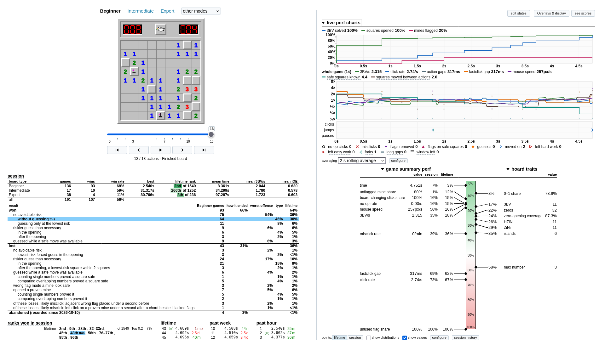
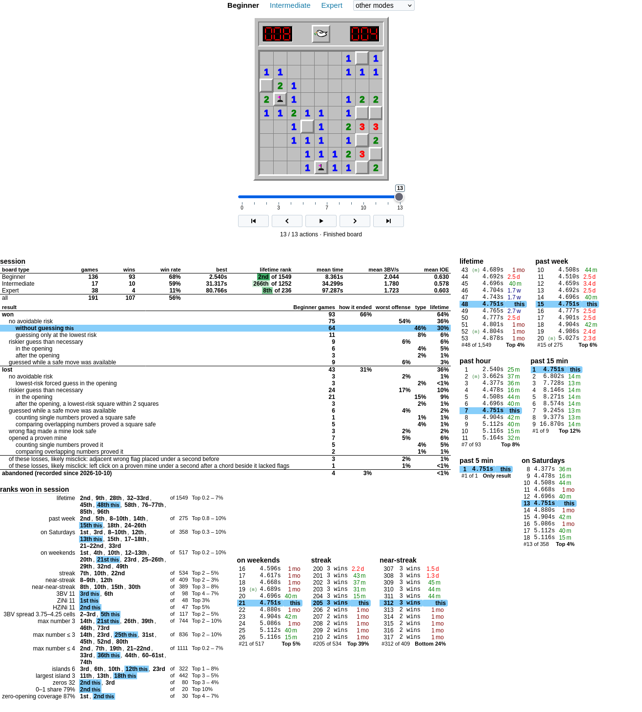
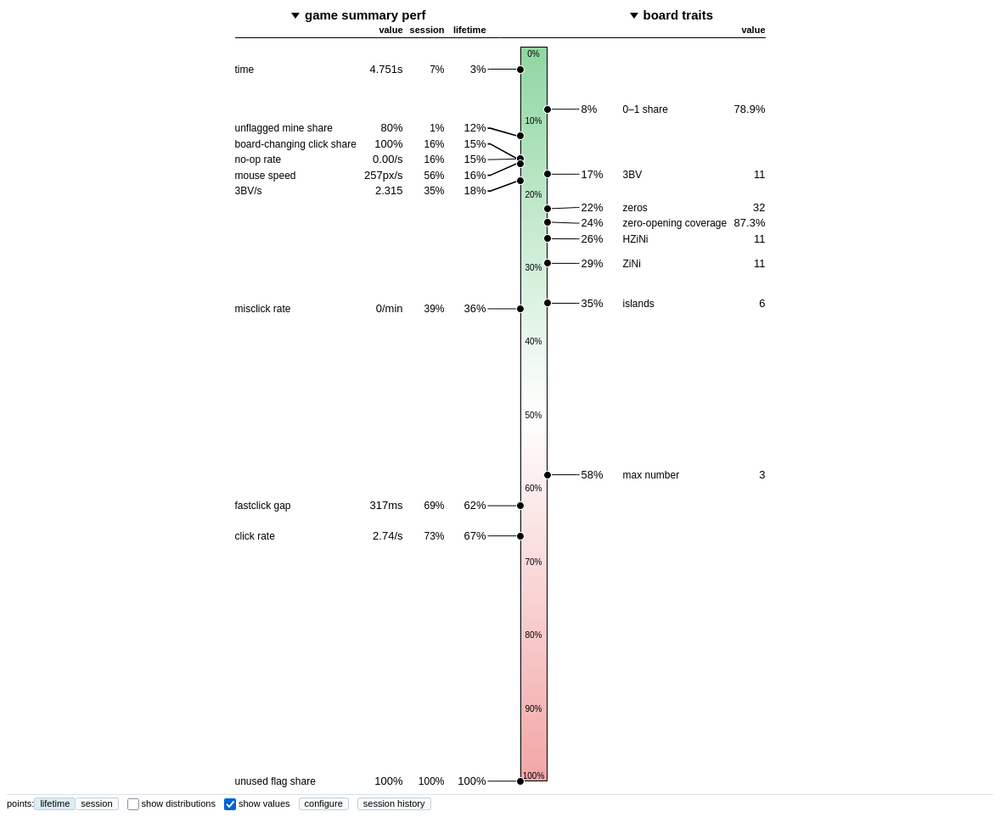
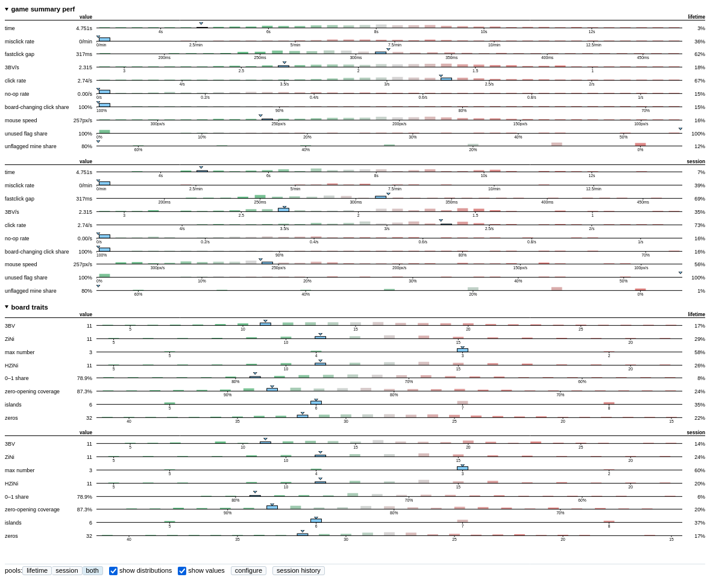
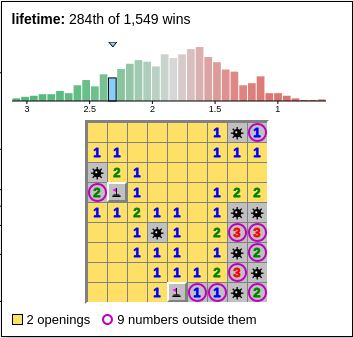
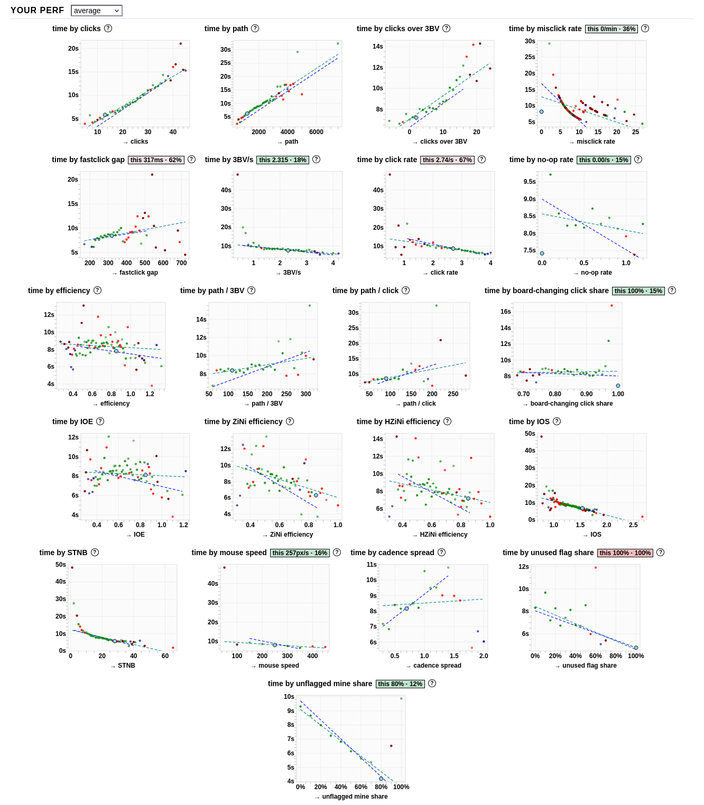
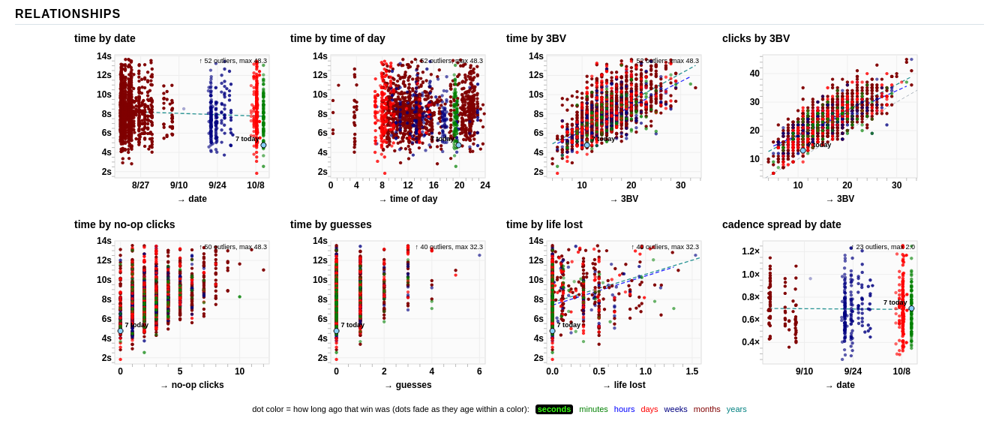

# minesweeper-friendly

**Play now: https://minesweeper-friendly.fuseki.net/**

Minesweeper variant project. Standard first-click-safe play, plus Angelic,
an Endgame drill (instantly dealt
realistic late-game remnants, always finishable by pure deduction), a
100-game Trial of 25 hidden boards shown four times each, Short trial
(4 boards × 4), and Test trial (1 board × 4). The 3BV countdown mode samples ten boards, ranks them by descending 3BV,
and deals them in that order with the upper-right cell opened automatically.
Persistent 3BV-versus-time charts below the board track the current ten-board
challenge and all wins in this mode/configuration since local midnight.
A run/3BV/time table beside them adds each result as the challenge proceeds
and keeps the latest completed run highlighted in light blue; it never adds
a distracting second live clock.
Beginner, Intermediate, and Expert are one-click choices; every other mode
is in the "other modes" menu beside them, and each keeps its own rankings.



## The page

The page is a row of fixed columns, so nothing that appears or disappears
ever moves the board:

- **Above the board.** Beginner, Intermediate, Expert, and the "other
  modes" menu: Custom and every other mode. Only a mode from that menu
  brings a second row: the board size, the generator where the mode uses
  one, and the mode's progress.
- **Top bar, upper right.** Today's use against your daily limits, once
  any is set, then the daily limits and settings buttons.
- **Settings row, page foot.** The rest of what you configure for every
  game: the page's one session picker (today by default,
  shared by every session comparison on the page), and the board display:
  Zoom, "position" (opens the board position editor), and the pixel ratio,
  which moves with the browser zoom. The footer under it links the
  self-check, training, and problems pages.
- **The board, center.** After a game the replay controls sit under it like
  a video player's (start, back, play at the pace it was played, forward,
  end), with on/off toggles for its board overlays and mouse path views
  under them. The session summary and "ranks won in
  session" sit beside it where they fit, otherwise they lead the tables
  under it. Then come the time-window, day-category, and streak rank lists,
  the "This board" tables, and the your-perf, board-trait, and relationship
  charts.
- **Live perf charts and game data, right of the board.** After any game,
  live perf charts show how it unfolded: progress, and each measured line
  against its own whole-game value, over tracks of clicks, jumps, and
  pauses; each jump is marked by why it happened: the local work had run
  out, had turned slow, or was still easy. After a win, game data places each measurement of this game on
  one percentile band against your lifetime and session games: game summary
  perf on one side and the board's traits on the other.
- **Game details, far right.** A line naming whether music is on and which
  of your states are on, as tags (changed through "edit states"), see
  scores, and the game's statistics. Every setting kept for all
  games, such as which result sections show, is on the settings page.
- **Motion stats, page foot**, closed until you open them: the
  mouse-dynamics measurements of the game on the board, live during play
  and final after it.

**Daily limits** (top of the settings page): play time, games, games per
level, and a stop time, each per play day from 4:00 to 4:00. A reached
limit lets the game in progress finish and closes the board until 4:00.
Every change is confirmed twice, and raising or removing a limit works only
before 2 minutes of play that day
([spec](docs/product/play-limits.md)).

On narrower windows game data moves into the details column, and below that
the details open from a **Game details** button.

## Run

No dependencies, no build step. Open `index.html` in a browser, or:

```bash
python3 -m http.server 8018 --bind 127.0.0.1
```

Then open exactly **http://127.0.0.1:8018/**. This is the canonical local
play origin: IndexedDB scores are origin-scoped, so `localhost:8018` or any
other host/port has separate history and must not be substituted.

### Persistent local server (Linux)

On PC, `minesweeper-friendly.service` owns the server at the exact address
above. It starts at boot, keeps running after logout, and restarts two seconds
after the server exits. User lingering is already enabled on this machine.

The [user unit](systemd/minesweeper-friendly.service) expects the checkout at
`~/proj/minesweeper-friendly` and Python at `/usr/bin/python3`. Install it with:

```bash
mkdir -p ~/.config/systemd/user
install -m 644 systemd/minesweeper-friendly.service ~/.config/systemd/user/
systemctl --user daemon-reload
systemctl --user enable --now minesweeper-friendly.service
```

On another machine, `loginctl enable-linger "$USER"` enables boot startup
and operation after logout. Manage the installed server through systemd;
do not start a second manual server on port 8018:

```bash
systemctl --user status minesweeper-friendly.service
systemctl --user restart minesweeper-friendly.service
journalctl --user -u minesweeper-friendly.service -n 30
```

An intentional `systemctl --user stop minesweeper-friendly.service` stays
stopped until started again or the next boot. To remove boot startup too,
use `systemctl --user disable --now minesweeper-friendly.service`.

## Controls

- Left click: reveal a cell (first click is never a mine)
- Right click: place/remove a flag
- Left click on a satisfied number: chord (open all unflagged neighbors)
- Face button or space bar: new game
- Presets (Standard play): Beginner 9x9/10 (default), Intermediate 16x16/40, Expert 30x16/99
- Other modes menu, each on a board you size: Custom (Standard play), 3BV countdown (ten boards, highest 3BV first), Angelic, Endgame drill, Trial, Short trial, Test trial, Board lab

## Endgame drill

Rapid endgame training: each new game deals a full board and reveals
everything except a small unopened patch against a board edge or corner —
where real endgames actually finish. Every deal keeps 4–45 covered safe
cells with genuine mine tension and is guaranteed finishable by pure
deduction, so a death is always a reading error, never a forced guess. The
timer starts on your first input, the recorded 3BV is the remnant's
remaining 3BV (what was actually left to solve), and the mode keeps its own
rankings. Deals are effectively instant, so the face button loops you
straight into the next position.

## Solver

Proofs use every mine layout consistent with the revealed numbers and total
mine count, not a fixed catalog of Minesweeper patterns. The engine solves
connected frontier constraints, combines their mine totals with the
unconstrained board, and marks a cell only when every valid layout agrees.
Flags and the hidden board are never treated as player knowledge. If the
explicit search budget is exhausted, the result is reported as incomplete;
the game does not turn that engine limit into a criticism.

## Play history

Every finished game, win or loss, is kept per mode in the browser's
IndexedDB (loaded into RAM at startup; persisted asynchronously). Each
record stores only the primary measurements — end date, outcome, time, 3BV,
clicks, chords, mouse path (total cursor distance in px from first click to
game end), the board's greedy and human ZiNi (the flaggers' counterparts to
3BV), the game's cadence spread (press-rhythm dispersion, wins and losses
alike), and the finished board's max number, sevens, zeros, and mine
islands; derived stats (3BV/s, efficiency, board-changing click share, IOS,
IOE, chord share, ZiNi efficiency, STNB on the standard board sizes, mouse
speed, and the rest) are
computed at display time. After each win the tables under the board rank it
in one list per time window. Day-and-longer windows anchor to your
local calendar: "today" since last midnight, "past week" since midnight six
days back, "this month" and "in <year>" since their calendar starts, and
"in the last year" since the end of the day exactly 365 days prior; hour /
15 min / 5 min / 1 min windows roll continuously. Then day-category columns:
all scores set on
today's weekday ("on Wednesdays"), on weekends or weekdays (whichever today
is), and on US federal holidays when today is one. Columns reveal
themselves gradually: a chart only appears once it would actually differ.
Lifetime and past week are pinned as long-term and recent anchors; duplicate
ordinary windows fold into the most specific surviving chart.
After a win there are also lists for boards that match this one's 3BV,
highest number (has an 8, has a 7, or no number above 4 / 3 / 2),
mine-island count, largest mine-island, and zero count.
Two blocks lead those lists. The session summary gives, per board type
played in the session, games, wins, win rate, the best time with its
lifetime rank, and mean time, 3BV/s, and IOE, then the session's games of
the board type just played (its size, mode, and generator) by result:
wins by how much guessing they survived (none, only the lowest risk, a
riskier guess in the opening or later, a guess past a proven-safe square),
losses by what went wrong, and boards abandoned before the end (restarted,
or the page closed), recorded since 2026-10-20. "Ranks won in session" names,
for every longer list, the top-tenth ranks earned within the session.



Game data replaces the winning game's stats grid. One green-to-red band
places each measurement by the share of comparable games that did better
(0% is the best): game summary perf on the left, each row showing this game's value
and its session and lifetime percentages, and board traits on the right,
ranked toward each trait's preferred end. Every pool holds only games with
this game's board settings. "points: lifetime | session" picks which pool
places the dots; the session is the page's one picker, shared with the
session summary and "ranks won in session". Hovering a row opens a card with
that pool's rank, a histogram of your games with this game's bar in light
blue under a pin, and, where the measurement counts something on the board,
this game's finished board in your board style with those squares marked
(the openings for 3BV, each misclick, each unflagged mine) and their
counts. "show distributions" swaps the band for one histogram strip per
measurement, each with its x ticks, in lifetime and session groups
("pools: lifetime | session | both"); the strips grow to fill the column
when measurements or a pool are hidden. "configure" picks the measurements from one list, "show
values" toggles the value column, and "session history" pages through
earlier session windows. Nothing in it scrolls: it scales to fit its column.
Each chart further down carries a chip with this game's value and standing,
and hovering a row outlines the charts that plot the same measurement. See
[the design and removed-field inventory](docs/product/game-data.md).

<p>
  
  
</p>



Property charts sit in two groups, your perf and board traits, each with
its own average, distribution, or winrate reading. They plot a measurement
against average win time, every win's time, or the share of games won.
Charts omit games where that measurement is absent.



After a loss or a trial game, the stats themselves (time, 3BV, 3BV/s, clicks, efficiency, board-changing click share,
IOS, mouse path,
mouse speed, path per click, path per 3BV, plus the per-game forms of the
session series: click rate, no-op rate, misclick rate, mark rate — derived
from stored counts — and the stored fastclick gap)
render as a small label/value table, "this game", among the tables under the board (beside the board where it fits), including no-op
clicks (board clicks that changed nothing — stored as `noOpClicks`,
named `wastedClicks` until 2026-10-27, since
2026-08-19; older records lack the measurement), flags placed (same
recording rules; a zero-flag game earns the special status "markless",
shown right in the row and as a small "(m)" before that game's time in
every rank list; a win played that way is not its own mode — its post-game
records are only the other markless games of that same board, and the
lifetime list is named "top expert no-mark times" or the matching board)
and, for wins, clicks over
3BV (clicks beyond the board's minimum). The after-game report groups each
action once by severity: game loss, game risk, time loss, optional
one-ply life maximization, or measurement notes. New players see none of
that report until they ask for it. Fatal scope shows only the fatal action
after a loss (a win has none at that scope). Risk/full
scope reports still show needless or higher-risk actions from games the
player won. Reports put the fatal action first, then sort survived risks by
highest selected actual death probability; lower-severity sections follow.
The inline “After each
game, show me” selector switches persistently among nothing, fatal only,
fatal plus risky actions, and full analysis. Full analysis explains the independent
facts (for example, proven mine plus a safe alternative), quantifies actual
risk after protection rules, and presents only the dimensions that differ
as short labeled facts. Saved positions crop away uniform covered remainder
while naming the shown row/column range; selected and alternative cells stay
highlighted. Bare reveals are evaluated without requiring flags or chords;
if nothing qualifies under the selected scope, no empty report card appears.
Below the rankings, relationship plots chart every win: win time vs
date, win time vs hour of day, 3BV vs time, clicks vs 3BV (with the clicks =
3BV floor drawn in), no-op clicks vs time, guesses vs time, life lost vs
time, and cadence spread over date. Dots are colored by how long
ago each win was (the rank-list age palette), and the just-finished game is
the black-ringed dot tagged with its rank among today's wins. Streak lists rank
your win runs: "streak" (consecutive wins), "near-streak" (runs spanning at
most 1 loss), and "near-near-streak" (at most 2), each row showing length
and how long ago the streak's last win was; recorded losses split the
streaks. Each list windows around your row, 11 rows max: when you rank in
the top 11 the list simply shows the top 11 with your row in place;
otherwise it centers on you with the 5 nearest entries either side. Rows
show rank (without a leading "#"), fixed-width time, and a relative age
("43s", "5m", "2.0w"; the brand-new score says "this").



Post-game output follows stable sections under the board: the action report
when one is shown; one wrapping list of tables (the session summary, ranks
won in session, the time and day-category rank lists, then every streak
list); the "This board" tables; then the your-perf charts, board-trait
charts, and relationships. Data tables always precede
the dot-plot charts, and each section wraps within its own rows, so viewport
width cannot mix them. The session summary and ranks won move beside the
board where each fits. The High scores view uses the same history sections but omits post-game
action analysis; its facts are explicitly labeled as
the latest win's stats and historical charts have no current-game marker.

The motion stats section at the page foot (closed until opened; the choice
is remembered) carries live self-observation without covering the board.
During a game it shows the game's mouse-dynamics measurements, each with
its sparkline, updated as you play; when the game ends, the same rows show
the complete trace, followed by a Fitts curve and a map of which board
regions your hand serves slower. These are observations, not
explanations: the app does not infer fatigue, attention, hardware trouble,
judgment, or any other cause from a change in a value.

Game data can add one line under its chart: switch cost, how much longer
the next press takes after you change buttons (flag versus click or chord)
than after repeating the same move over the same distance. It gives the
time this game's switches added, in seconds at your latest 500 games'
estimate, then the estimate over three pools of standard games with saved
traces: the session's, your latest 500, and the 500 before those, so you
can see whether practice is shrinking it. Its label opens each pool's 95%
interval, the cost per switch in milliseconds and per Beginner,
Intermediate, and Expert game in seconds, the share of moves that switch,
and the game count. One game has too few presses to measure the cost on
its own, so a game's seconds use the pooled estimate. Configure turns it
on, as it does the optional rows: flag and flag-removal rates, the
report's mistake categories per minute, excess game risk, and modeled life
gap.

The home-page score buttons open the same full result view for Beginner,
Intermediate, or Expert without requiring a new game; historical views have
no "this" marker. The settings page's "shown things" group (the
"settings" button top-right leads there) controls each result section. The
last-1-minute list, largest-island items, and near-near-streak list start
hidden.

Preferences remember board selection, custom dimensions, zoom, path and replay
controls, panel state, player tags, drafts, and scroll positions. Settings has
separate **Export preferences** and **Import preferences JSON** controls;
history transfers never apply preferences.

Backup: subtle "export history" / "import history" controls under the
results. Export copies the full history JSON to the clipboard (with a
save-to-file option), omitting irreparable records and invalid optional
fields; import accepts pasted JSON or a file, recovers every usable record
and field, and merges with dedupe by each record's end timestamp, so
re-importing the same blob is always safe. Ages are
color-coded by unit following the board-number palette: seconds
fluorescent green (always bold), minutes green, hours blue, days red, then
navy/maroon/teal for weeks/months/years. Losses show the same stats table
as wins and are recorded in full; they are not ranked.

## Documentation

- [PRODUCT.md](PRODUCT.md) indexes the product specification, one file
  per area under `docs/product/`.
- [AGENTS.md](AGENTS.md) is the agent index: standing rules, plus the spec
  and implementation-notes path for every area.
- [BACKLOG.md](BACKLOG.md) lists unbuilt work.


## Public site

The game is live at `https://minesweeper-friendly.fuseki.net/`. Every push to
master is tested and then released there. `https://ernop.github.io/minesweeper-friendly/`
redirects to that origin. [Hosting status and deployment](docs/implementation/hosting.md)
explains the runtime-only artifact, restricted upload account, and tests.
The hosted site records [play statistics](docs/product/hosting.md#play-statistics)
(a random player number, active time, and game results) on its own server;
local copies send nothing.
